# Securing Mission-Critical UAV Metadata

## Abstract

This project protects UAV image metadata by filtering and canonically serializing trusted fields, encrypting them with AES-256-GCM, shuffling the ciphertext bits with a mission key, and embedding the result with reversible data hiding. The decoder extracts and restores the original pixels bit-for-bit, authenticates the payload, verifies the cover binding, and reports an explicit verdict.

The repository includes a FastAPI ground-station service, a Streamlit demonstration dashboard, dataset evaluation tooling, optional Aletheia structural LSB analysis, and a Raspberry Pi-oriented benchmark.

## Architecture

```mermaid
flowchart LR
    A[Image or video capture] --> B[Cover preprocessing]
    B --> C[EXIF/XMP and SRT extraction]
    C --> D[Whitelist and canonical CBOR]
    D --> E[AES-256-GCM]
    E --> F[SSA-inspired keyed bit shuffle]
    F --> G[Prediction-error RDH]
    G --> H[Metadata-free PNG]
    H --> I[RDH extraction and cover restoration]
    I --> J[Inverse shuffle]
    J --> K[AES-GCM authentication]
    K --> L[Cover binding hash and verdict]
```



## Module Mapping

| Architecture responsibility | File | Main functions/classes |
|---|---|---|
| Configuration and paths | `uavsec/config.py` | `Config` |
| Custom exceptions | `uavsec/errors.py` | `CapacityError`, `ExtractionError`, `AuthenticationError` |
| HKDF key manager | `uavsec/keys.py` | `generate_master_key`, `load_master_key`, `derive_keys`, `KeySet` |
| Image/video capture | `uavsec/capture.py` | `load_image`, `extract_keyframe` |
| Cover normalization and binding hash | `uavsec/cover.py` | `preprocess`, `cover_hash`, `save_stripped_png`, `load_png` |
| EXIF/XMP and SRT metadata | `uavsec/metadata.py` | `extract_exif_xmp`, `parse_srt`, `telemetry_for_frame` |
| Whitelist and CBOR | `uavsec/serializer.py` | `filter_metadata`, `serialize`, `deserialize` |
| AES-256-GCM | `uavsec/crypto.py` | `encrypt`, `decrypt` |
| Keyed bit permutation | `uavsec/shuffler.py` | `bytes_to_bits`, `bits_to_bytes`, `shuffle`, `unshuffle` |
| Reversible data hiding | `uavsec/rdh.py` | `capacity_bits`, `embed`, `extract` |
| End-to-end orchestration | `uavsec/pipeline.py` | `encode`, `decode`, `EncodeResult`, `DecodeResult` |
| Quality metrics | `uavsec/metrics.py` | `psnr`, `ssim`, `embedding_rate`, `bit_exact` |
| Optional Aletheia analysis | `uavsec/steganalysis.py` | `run_aletheia` |
| SQLite operation history | `uavsec/db.py` | `init_db`, `log_operation`, `list_operations`, `get_operation` |
| HTTP ground-station API | `api/main.py` | `/encode`, `/decode`, `/attack`, `/files`, `/operations`, `/health` |
| Demonstration UI | `ui/app.py` | Streamlit pages for overview, encode, decode, attacks, evaluation, history |
| Dataset evaluation | `scripts/evaluate.py` | `evaluate_image`, `write_evaluation`, `main` |
| Pi/laptop benchmark | `scripts/benchmark_pi.py` | `benchmark_resolution`, `write_benchmark`, `main` |

## Setup

The required runtime is Python 3.11. Create and activate a virtual environment:

### Windows PowerShell

```powershell
py -3.11 -m venv .venv
.\.venv\Scripts\Activate.ps1
python -m pip install --upgrade pip
pip install -r requirements.txt
```

### Linux

```bash
python3.11 -m venv .venv
source .venv/bin/activate
python -m pip install --upgrade pip
pip install -r requirements.txt
```

### Raspberry Pi 4

```bash
sudo apt update
sudo apt install -y python3.11 python3.11-venv python3-pip libimage-exiftool-perl
python3.11 -m venv .venv
source .venv/bin/activate
pip install --upgrade pip
pip install -r requirements.txt
```

PyExifTool requires the ExifTool executable. The commands above install it on Debian-based systems. On Windows, install ExifTool from the official ExifTool distribution and place `exiftool.exe` on `PATH`. On macOS, use the platform package manager or the official distribution.

Aletheia is optional and is called only as an external CLI. Install it from its project distribution, then set its executable or script path:

```bash
export ALETHEIA_PATH=/path/to/aletheia
```

Without this variable, evaluation records `not configured` for SPA and RS scores and continues.

Set one 32-byte master key as hexadecimal. It is read once by the API at startup:

```bash
export UAVSEC_MASTER_KEY=$(python -m uavsec keygen)
```

Do not commit the key or `data/master.key`.

## Running

Start the API:

```bash
uvicorn api.main:app --host 127.0.0.1 --port 8000
```

Start the UI in another terminal:

```bash
streamlit run ui/app.py --server.port 8501
```

Open <http://127.0.0.1:8501>. The UI communicates with the API using `requests`; it does not duplicate encryption, RDH, or metadata logic.

The CLI supports smoke tests and scripted use:

```bash
python -m uavsec keygen
python -m uavsec encode cover.png mission-7 --master-key "$UAVSEC_MASTER_KEY" --out outputs/stego.png
python -m uavsec decode outputs/stego.png mission-7 --master-key "$UAVSEC_MASTER_KEY"
```

Run tests with:

```bash
pytest -q
```

## Evaluation

Evaluate a dataset containing supported image formats:

```bash
python scripts/evaluate.py /path/to/dataset --limit 100
```

Outputs are written under `outputs/eval/`:

- `results.csv`
- `summary.md`
- PSNR and SSIM distributions
- timing bars
- capacity versus payload
- tamper detection rate
- proposed versus LSB baseline

Benchmark the pipeline at 720p, 1080p, and 4K:

```bash
python scripts/benchmark_pi.py --runs 3
```

The benchmark writes `benchmark_<hostname>.csv` and a stage-wise PNG chart under `outputs/eval/`.

### Results

| Artifact | Status |
|---|---|
| `outputs/eval/results.csv` | Generated by `scripts/evaluate.py` when a dataset is supplied |
| `outputs/eval/summary.md` | Generated with mean and standard deviation per dataset |
| PSNR / SSIM / timing / capacity / tamper / baseline plots | Generated with the evaluation run |

The repository’s automated three-image evaluation test verifies the complete CSV schema and all six figures. No external benchmark dataset was committed to this repository.

## Security Review Notes

- AES-GCM uses a fresh 12-byte `os.urandom` nonce for every encryption. Nonces and ciphertext are carried in the payload, not reused or persisted as keys.
- Master keys and derived keys are kept in process memory only. They are not written to SQLite, trace previews, API JSON, or output PNG metadata.
- The output writer passes empty EXIF and PNG metadata structures; the tests verify `Image.info == {}`.
- RDH cover/error/prediction arithmetic uses `int32` and casts to `uint8` only for final image output.
- `decode()` converts extraction and authentication failures into `TAMPERED_PAYLOAD`, and binding failures into `BINDING_MISMATCH`; hostile payloads do not escape as exceptions.
- SQLite writes use parameterized SQL and a separate connection per public operation.

## Limitations

- Aletheia is an external optional dependency and its output format can vary by release; raw detector output is retained and numeric parsing is best-effort.
- Video capture requires OpenCV and a codec supported by the host installation.
- Prediction-error capacity depends strongly on image texture and may be zero for noisy covers.
- The API file registry is process-local; production deployment should replace it with durable object storage and authenticated access controls.
- The demo master-key environment variable is suitable for local testing only. Production key custody should use a dedicated secret manager.

## References

- Project specification: `PROJECT_SPEC.md`
- Workspace engineering rules: `.github/copilot-instructions.md`
- AES-GCM and HKDF: Python `cryptography` documentation
- Canonical CBOR: `cbor2` documentation
- Reversible data hiding: prediction-error expansion and histogram-shifting literature
- Aletheia: external steganalysis CLI documentation and README
- EXIF/XMP extraction: ExifTool and PyExifTool documentation
- Image metrics: scikit-image PSNR and structural similarity documentation